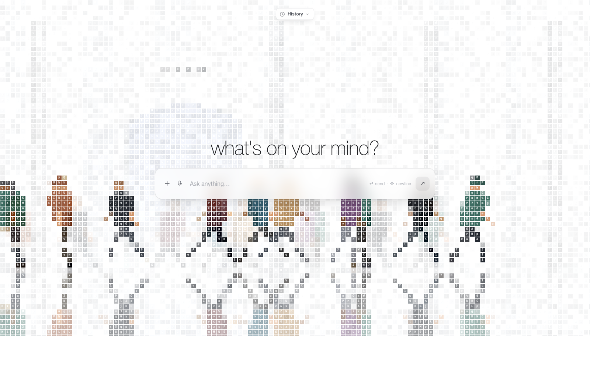

# subway — mosaic


A rebuild of the effect from `Downloads/shark.mp4`: a scene quantised into a
grid of tiny character chips, with a soft blurred ghost drifting behind it
and a mirrored reflection in the pavement below.

Instead of sharks, the scene is a **slice of street level outside a subway
entrance**: a stairwell with a SUBWAY roundel, and a stream of commuters
walking out of the stairs in different clothes.



▶ **[media/demo.mp4](media/demo.mp4)** — 5 seconds, 1280×720, 30 fps.

```
subway-mosaic/
├── index.html
├── serve.py            tiny dev server (also logs frame stats, records frames)
├── media/              screenshot + demo
├── css/styles.css
└── js/
    ├── main.js      loop, resize, blur chain
    ├── scene.js     the "photo": station, stairwell, crowd
    ├── person.js    procedurally drawn pedestrians (profile)
    ├── mosaic.js    WebGL chip shader
    ├── capture.js   frame recorder (loaded only for ?export=1)
    └── atlas.js     8×8 glyph atlas
```

## Run it

ES modules need a server — `file://` will not work.

```sh
cd subway-mosaic
python3 serve.py 8777      # → http://localhost:8777
```

`serve.py` also accepts `POST /stats`, which the page uses when you open
it with `?perf=1`, so you can watch the frame rate from your terminal.

## How the effect works

The reference is not a photo filter — it is a **character mosaic**. Every
~10px cell of the frame holds one small glyph, and the cell's *flat
background colour* is a sample of the underlying image. Where the image is
white the chip disappears into the page; where the image is dark the chip
carries its colour and a white letter on top. The subject is therefore
rebuilt out of type.

`js/mosaic.js` reproduces it in one fragment shader:

| stage | what happens |
|---|---|
| quantise | `floor(fragCoord / cell)` picks the chip, the scene is sampled at the chip's centre so each chip is a flat colour |
| gap | each chip occupies 86% of its cell, leaving a thin white seam |
| glyph | a per-cell hash picks one of 64 characters, re-rolled on the cell's own clock so the field shimmers |
| emboss | the glyph is drawn as a white face with a faint dark shadow, so it reads on dark chips and only ghosts on pale ones |
| ghost | a heavily blurred, slowly drifting copy of the scene adds "ink" wherever the sharp pass is near-white |
| mirror | below the axis the scene is sampled flipped about that line, faded with distance, over a cool channel gradient |

The scene itself is drawn on a 2D canvas and uploaded as a texture. Three
copies are kept: sharp, blurred ¼, blurred ⅛ — the chain of halvings gives
a smooth falloff for almost no cost, and only the small ones are uploaded
each frame.

## The crowd

`js/person.js` draws every pedestrian from scratch — no sprites, no
assets. A walker is a record of proportions and a colour story (top,
trousers, shoes, skin, hair style, hat, and one accessory such as a
backpack, tote, briefcase, coffee, phone or headphones), re-drawn each
frame with a phase-driven walk cycle: swinging legs and arms, a body bob
and a slight forward lean.

`js/scene.js` keeps the stairwell on the left with a SUBWAY roundel, and
releases people out of it in both directions. The queue logic means
nobody overtakes anybody, so the crowd stays legible instead of collapsing
into a clump.

## Tuning

Constants live in a few obvious places:

- `js/main.js` → `cell` (chip size), `echo` (ghost strength), `pan`
- `js/scene.js` → `groundY`, `entranceX`, spawn rate
- `js/person.js` → `H` (figure height), the `TOPS` / `BOTTOMS` / `HAIR` palettes
- `js/mosaic.js` → the shader's `FILL` (chip gap), `uEcho`, reflection fade

`?debug=1` draws the raw scene, the ground line and an fps counter over
the top. `?perf=1` logs frame timings to the console and posts them to
the dev server.

`prefers-reduced-motion` stops the camera drift and softens the ghost.

## Recording a demo

`js/capture.js` renders the animation frame by frame at a fixed timestep,
reads each frame back off the WebGL canvas, draws the interface over it and
POSTs the result to the dev server, which writes it to `media/frames/`.

```sh
python3 serve.py 8777
rm -rf media/frames && mkdir -p media/frames
open "http://localhost:8777/?export=1"      # writes 150 jpgs

cd media
ffmpeg -framerate 30 -i frames/%04d.jpg \
       -vf "crop=1280:712:0:0,scale=1280:720" \
       -c:v libx264 -pix_fmt yuv420p -crf 20 -movflags +faststart demo.mp4
```

`media/demo.gif` is the same run downscaled to 520px at 10 fps.
